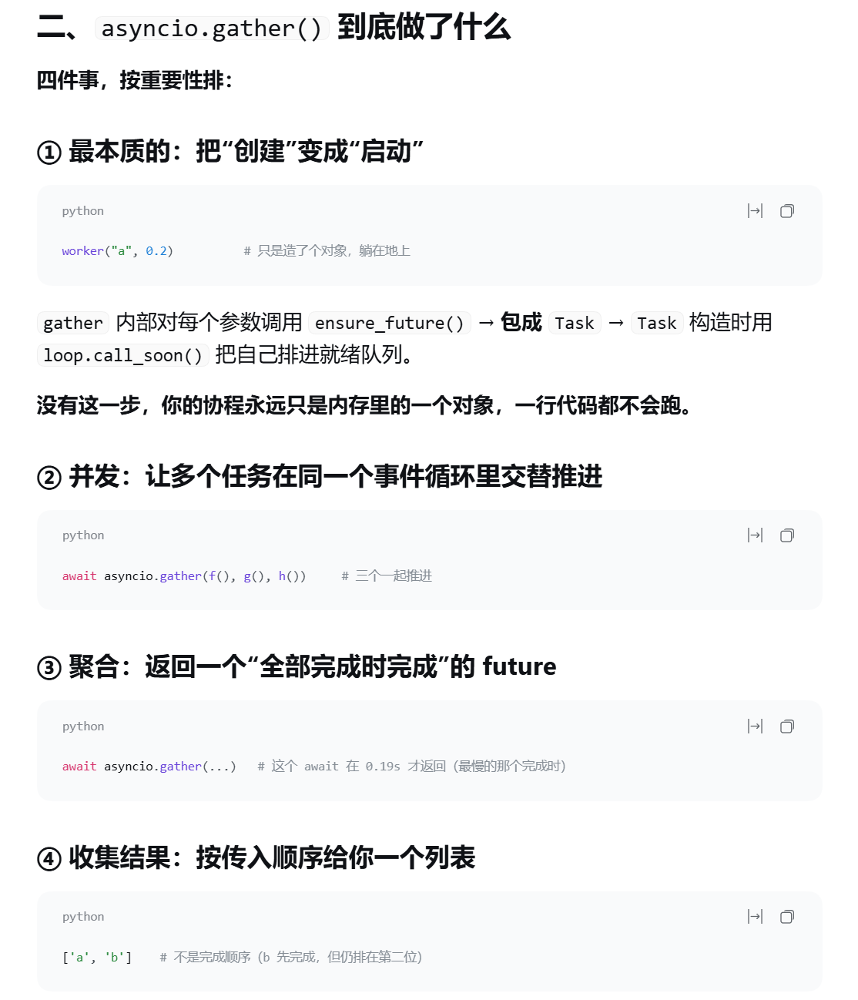
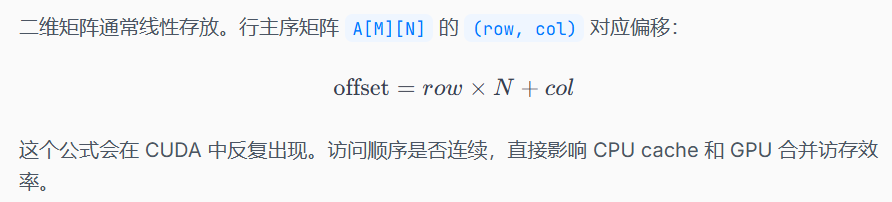

## 一.前置基础

### 1.核心理念

明确一个观点，所有的优化都是在计算、通信和显存的不可能三角中做取舍，学习时候始终要记住，这个技术牺牲了什么，换取了什么

### 2.编程语言基础

#### 2.1 三层语言

编排层Python、Shell，系统层C/C++，设备层CUDA C++，Triton，AI infra工程师最重要的语言能力是沿调用链跨层追踪问题

#### 2.2 常见命令工具箱

```bash
python --version       # 正在使用哪个 Python
which python           # 这个可执行文件来自哪里
python -m pip --version

g++ --version          # C++ 编译器版本
cmake --version        # 构建系统版本

uname -a               # 内核与系统信息
ps aux                 # 有哪些进程
free -h                # 主机内存使用
df -h                   # 文件系统容量

nvidia-smi             # 驱动可见的 GPU 与进程
nvcc --version         # CUDA Toolkit 中的编译器版本
```

#### 2.3 python脚本到工程

1.Python 变量更准确的说法是“**名字绑定到对象**”，写函数时自问一句：我这个函数是“改造了传进来的东西”，还是“做了个新东西返回出去”？这两者的语义完全不同，接口设计时要想清楚

2.常见不可变对象包括 `int`、`float`、`bool`、`str`、`bytes` 和元素均不可变时的 `tuple`；常见可变对象包括 `list`、`dict`、`set` 和大多数自定义实例。

3.|表示联合类型，int|string表达的是，int和string类型都可以

4.

```python
# 错误：同一个列表会被多次调用共享
def collect_bad(x: int, result: list[int] = []) -> list[int]:
    result.append(x)
    return result

collect_bad(1) -> [1]        id=1459917953216
collect_bad(2) -> [1, 2]     id=1459917953216
collect_bad(3) -> [1, 2, 3]  id=1459917953216     ← 三次是同一个列表！

#这里的严重问题在于局部变量 result 每次调用都是新创建的，并非同一个变量，但每次它都绑定到同一个列表对象（存在 __defaults__ 里的那个），累加发生在那个对象里，不是发生在变量里

# 正确：用 None 表示“未提供”
def collect(x: int, result: list[int] | None = None) -> list[int]:
    if result is None:
        result = []
    result.append(x)
    return result

```

这部分代码里需要注意的是，if result is None和if not result可完全不是一个东西，后者只是判断了，result为不为真，例如[]是false但是不是None

5.深拷贝和浅拷贝

```python
import copy

src = [[1], [2]]
shallow = src.copy()           # 只复制最外层列表
deep = copy.deepcopy(src)      # 递归复制内部对象

shallow[0].append(9)
print(src)                     # [[1, 9], [2]]
print(deep)                    # [[1], [2]]

shallow = src.copy()      # 新外层 S，但 S[0] 还是 B，S[1] 还是 C
deep = copy.deepcopy(src) # 新外层 + 新内层 B'、C'
```

6.Python 按 LEGB 顺序查找名字：Local（当前函数内部，函数参数、函数里赋值的变量）→ Enclosing（外层函数，闭包，内层函数看到外层函数的变量）→ Global（模块）→ Builtins（内置）。

```python
x = 1
def f():
    print(x)     # 报 UnboundLocalError！
    x = 2        # 因为函数里出现了对 x 的赋值，x 在整个函数内都被判定为 local
    
#核心思想，函数里只要给某个名字赋过值，它在整个函数里就是局部变量，和"先读到未赋值的局部变量"冲突就报错
```

在 Python 里，函数本身也是一个"值"，可以赋值给变量、放进列表、被返回；只有写出名字(...) 时才真正执行它。 

```python
from collections.abc import Callable

def make_multiplier(scale: float) -> Callable[[float], float]:
    def multiply(x: float) -> float:
        return x * scale
    return multiply

double = make_multiplier(2.0)
print(double(3.0))  # 6.0
#double就是一个函数对象，类型是function
#可以理解成：make_multiplier(2.0) 造出了一台"乘以 2"的机器，double 是这台机器的名字；double(3.0) 才是把 3.0 塞进机器里运行。再调用一次 make_multiplier(10) 会造出另一台"乘以 10"的机器，两台互不影响，各自记着自己的 scale。

-----------------------------------------------------------------------------

# 三个函数最终都读取同一个 i，结果都是 2
bad = [lambda: i for i in range(3)]

# 用默认参数在每轮定义时保存当前值
good = [lambda i=i: i for i in range(3)]
print([fn() for fn in good])  # [0, 1, 2]

```

lambda是匿名函数的简写，格式是lambda参数: 表达式，这里bad是一个三个函数对象的list列表

7.Python 的特殊方法让对象接入语言协议。例如，实现 `__len__` 后可调用 `len(obj)`，实现 `__iter__` 后可被 `for` 遍历。

8.@表示装饰器，@dataclass是类装饰器，@classmethod是方法装饰器，让方法的第一个参数变成类本身

**`@dataclass` 是「自动写代码」的机器**（省掉手写 `__init__`/`__repr__`/`__eq__`）； **`@classmethod` 是「把第一个参数换成类」的开关**（省掉先造实例才能调用的麻烦）。

9.迭代器和生成器：按需生产数据

yield是生成器函数，iterator是迭代器，生成器函数是编写迭代器的简介方式，**函数体内只要出现 `yield`，整个函数就变成生成器函数**——不管你调多少次，它都不会像普通函数那样直接跑完返回结果。

10.**装饰器就是一个普通函数：接收一个可调用对象，返回另一个可调用对象。** `@` 只是语法糖。

在调用边界附加行为

```python
from collections.abc import Callable
from functools import wraps
from time import perf_counter
from typing import ParamSpec, TypeVar

P = ParamSpec("P")
R = TypeVar("R")

def timed(fn: Callable[P, R]) -> Callable[P, R]:
    @wraps(fn)
    def wrapper(*args: P.args, **kwargs: P.kwargs) -> R:
        start = perf_counter()
        try:
            return fn(*args, **kwargs)
        finally:
            elapsed_ms = (perf_counter() - start) * 1_000
            print(f"{fn.__name__}: {elapsed_ms:.3f} ms")
    return wrapper

@timed
def preprocess(values: list[float]) -> list[float]:
    return [value * 2 for value in values]


##  @timed = 在函数调用前后加计时代码；@wraps(fn) = 保留原函数名和文档，让装饰后"看起来还是原函数"。
##  @timed 等价于 preprocess = timed(preprocess)。functools.wraps 会保留函数名、文档字符串等属性，这对日志、测试和框架反射很重要。
```

11.上下文管理器

```python
from contextlib import contextmanager
from collections.abc import Iterator
from time import perf_counter

@contextmanager
def timer(name: str) -> Iterator[None]:
    start = perf_counter()
    try:
        yield
    finally:
        elapsed_ms = (perf_counter() - start) * 1_000
        print(f"{name}: {elapsed_ms:.3f} ms")

with timer("load data"):
    data = [value for value in range(100_000)]

    
## 如果只是单个调用点需要计时，一个普通的 with timer(): 往往更直白，不必为了“高级”而使用装饰器。
```

with语句是成对的准备收尾动作，收尾一定执行，所以 `with timer("load data"):` 的意思是：进入这个块时启动计时，离开块时打印耗时。

@contextmanager装饰器相当于把一个“生成器函数”改造成上下文管理器，`yield` 之前的代码 = `__enter__` 里做的事；`yield` 本身 = 交出控制权，`with` 块在这里执行；`yield` 之后的代码 = `__exit__` 里做的事，`@contextmanager` 是把普通生成器函数变成 `with` 能用的工具。

不是 `with` 需要"装饰器"，而是 `with` 需要对象有 `__enter__`/`__exit__`；文件、锁、数据库连接天生就有，而你的生成器没有，`@contextmanager` 就是帮你把这两条"缝隙"补上，让 `with` 能驱动它，所以「任何实现了 `__enter__` 和 `__exit__` 的对象 = 上下文管理器」，而 `@contextmanager` 只是帮你少写这两个方法的快捷方式。

12.@dataclass是类装饰器，给类嵌入了三个特殊函数

```python
from dataclasses import dataclass
from collections.abc import Sequence

@dataclass(frozen=True)
class ShardSpec:
    rank: int
    world_size: int

def shard(values: Sequence[int], spec: ShardSpec) -> Sequence[int]:
    return values[spec.rank::spec.world_size]


# Sequence[int]	“给我任何能切片的整数序列”，我不改它
# ShardSpec(frozen=True)	“这份 rank/world_size 的规格一旦定下就不会变”，可缓存可当 key
# values[rank::world_size]	“从第 rank 个开始，每 world_size 个取一个” → 每个 worker 拿到自己那一份
```

#### 2.4 python并发与性能分析 

1.并发并行

**并发（concurrency）**：多个任务在同一时间段内推进；

**并行（parallelism）**：多个任务在同一时刻真正执行。

2.GIL是一个进程级别的互斥锁，CPython用来保护自己内部状态，同一进程中，通常只有一个线程能同时执行 Python 字节码，字节码是编译之后的给python虚拟机看的指令序列，CPython 是这门语言最主流的实现

```
进程（独立内存）
├── 线程 A ──┐
├── 线程 B ──┼──→ 抢同一把 GIL ──→ 同一时刻只有一个能执行字节码
└── 线程 C ──┘
```

Python CPU 密集是说时间花在 CPython 虚拟机**逐条 dispatch 字节码**上。GIL 全程被占着 → 多线程 = 0 加速

GIL并不是让多线程没用，脑子里需要知道，什么情况下线程会失效、什么情况下不会

判断一个 Python 程序能不能靠多线程提速，只需要问一句：这段时间里，线程是在“跑 Python 字节码”，还是在“等”或者“跑 C 代码”？ 前者不能并行，后两者可以。

3.多进程：绕开GIL，但是数据搬运有成本

多进程的本质是花钱购买真正的并行能力： GIL 收的是“并行税”（同进程内线程没法同时跑 Python 代码），多进程免了这笔税；但每次跨进程都要付“搬运费”。 只有当“计算量 ≫ 搬运量”时，多进程才划算。

多进程的主要成本包括：

- 创建进程和独立解释器
- 参数与返回值的序列化/反序列化；
- 复制或映射内存
- 进程间通信与同步

`if __name__ == "__main__":` 对使用 `spawn` 启动子进程的平台尤其重要，可避免子进程重新导入模块时递归创建新进程，守卫，避免再次执行创建进程池

4.asyncio：协作式I/O并发，用事件循环调度协程

协程只在await处主动让出控制权，当任务在等待的时候，将线程给别的任务用，之前是一个线程做一个任务，任务等待的时候也占用了这个线程，当你使用了asyncio时，一个线程处理一万个任务，谁好了就处理谁，任务等待的时候去做别的任务

```python
import asyncio

async def worker(name: str, delay: float) -> str:
    await asyncio.sleep(delay)  # 模拟非阻塞 I/O
    return name

async def main() -> None:
    results = await asyncio.gather(
        worker("a", 0.2),
        worker("b", 0.1),
    )
    print(results)

asyncio.run(main())

```

什么是协程，`async def` 定义的函数。**调用它不会立刻执行**，只是返回一个待办事项对象，worker("a", 0.2)

什么是事件循环，一个 `while` 循环 + 就绪队列 + 定时器堆。它不停问“谁准备好了”，把准备好的任务推进一小步，asyncio.run(main())创建的就是事件循环

什么是await，唯一的让出点，我这里要等，让别人先跑， await asyncio.sleep(delay)

理解：我们在调用async def函数时候（也就是协程），函数体压根不会执行，它只会返回一个协程对象，有三个路启动它

await worker("a", 0.2)                          # ① 直接 await
asyncio.create_task(worker("a", 0.2))           # ② 包成 Task
asyncio.gather(worker("a", 0.2), ...)           # ③ 交给 gather（内部也是 ②）

上面这段代码里，worker("a", 0.2)跑到await asyncio.sleep(delay)被挂起，worker("b", 0.1)跑到worker("b", 0.1)也被挂起



5.正确做基准测试

**性能数字只有在测量方法正确时才有意义**，别只测一次、别把初始化算进去、别在异步系统上用 CPU 计时器直接当执行时间——**先定义清楚你测的是什么，再让测量方式配得上这个定义**

6.从慢定位到具体代码的顺序

建议按由粗到细的顺序：

1. **端到端计时**：确认回归真实存在；
2. **阶段计时**：区分数据、计算、通信和保存；
3. **函数级 profiling**：用 `cProfile` 找累计耗时高的函数；
4. **行级/采样 profiling**：进一步定位热点行或原生调用栈；
5. **内存 profiling**：用 `tracemalloc` 等工具找 Python 分配增长；
6. **GPU profiling**：进入 PyTorch Profiler、Nsight Systems/Compute 等专用工具。

7.python性能优化的优先级

①先改算法复杂度和数据结构；

②减少不必要的 I/O、复制和序列化；

③把细粒度 Python 循环改成批处理/向量化原生算子；

④减少 Python 与 C++/GPU 边界的频繁往返；

⑤确认热点后，再写 C++、CUDA 或 Triton 扩展。

#### 2.5 C/C++：内存、生命周期与资源管理

1.值、地址、指针与引用

```c++
&表示引用，&value表示value的地址
*表示指针，int* ptr表示指向int的指针
int& ref = value，int&表示别名，ref就是value
*ptr表示解引用指针
指针可以为空，可以重定向
    
void consume(T value);          // 按值：函数获得自己的对象
void update(T& value);          // 可变借用：函数会修改调用方对象
void inspect(const T& value);   // 只读借用：避免复制
void optional(T* value);        // 指针可能为空，通常不拥有对象

```

2.数组、指针与连续内存

**原生数组在大多数表达式中会退化为首元素指针，长度信息丢失**（`sizeof(arr)` 在函数里只剩指针大小）

```c++
//老式C, 老式 C API（包括 CUDA）的签名几乎都是 指针 + 长度
void scale(float* data, std::size_t size, float factor) {
    for (std::size_t i = 0; i < size; ++i) {
        data[i] *= factor;
    }
}

//data[i] 等价于 *(data + i)：指针先往后跳 i × sizeof(float) 字节，再解引用；*= 是原地写入，改的就是调用方的内存


//现代C
#include <span>

void scale(std::span<float> values, float factor) {
    for (float& value : values) {
        value *= factor;
    }
}

//for (float value : values) 是按值拷贝，循环里改 value 不会影响原数组；必须是 float& 或 const float&，代码里value是别名，是引用，改动的话就会改动原数组的内容
```

`std::span` 不拥有数据，只是“指针 + 长度”的轻量视图。调用期间底层内存必须仍然有效。

第一段是「指针 + 长度」的经典 C 风格：知道起点、必须自己带长度，灵活但容易出错；第二段用 `std::span` 把「指针 + 长度」打包成一个不拥有数据的视图，参数更少、更通用、更安全。**读别人代码时两种都会遇到，CUDA kernel 里至今主要还是第一种。**

3.矩阵，内存是一维的，"二维矩阵"只是我们脑补出来的形状。矩阵在内存里实际是一行接一行平铺存储的（行主序，row-major，C/C++/NumPy/PyTorch 默认）



**`offset = row × N + col` 把二维坐标换算成一维内存地址**；记住两件事就够了：① CUDA 里只有扁平指针，必须手算它；② 按行连续访问快、跨列跳跃访问慢，这条规律贯穿缓存、合并访存和 tensor 布局。

GEMM、卷积、Attention 的 kernel 里，全都在做 `row * N + col` 这类地址计算，以及更一般的形式 `row * ld + col`（`ld` = leading dimension，因为矩阵可能只是大矩阵里切出来的一块子矩阵）


